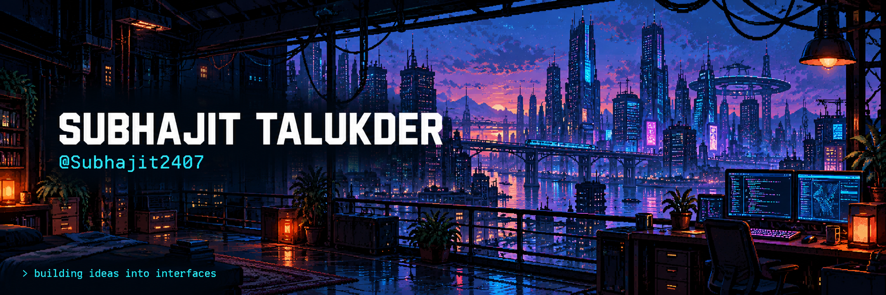
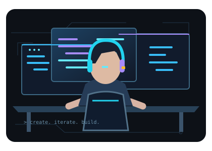
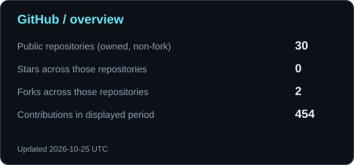
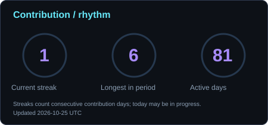
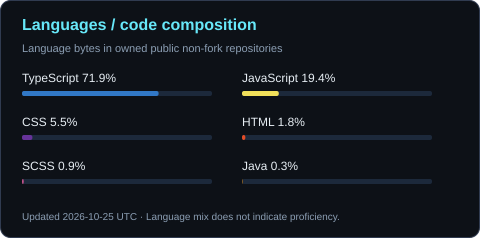
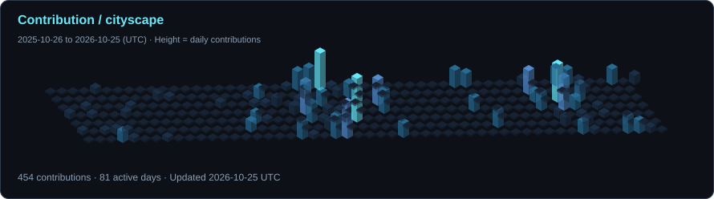
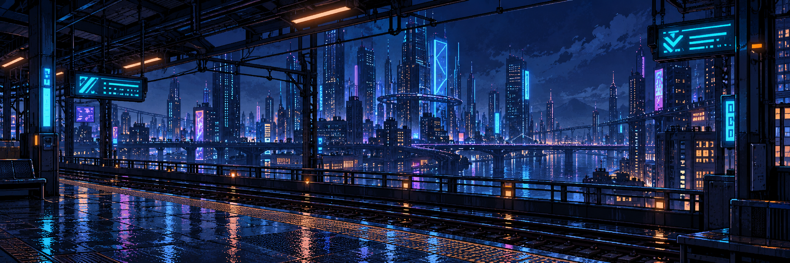

  

<h1 align="center">Subhajit Here 🔥!</h1>
<h3 align="center">Namaste 🙏! I'm Subhajit Talukder</h3>

<samp>Creative interfaces · Thoughtful interactions · Useful products</samp>

## 💫 About Me

- 🧑‍💻 I'm a B.Tech student at Jain University, building interactive web experiences.
- 🎨 My focus is **frontend development**, creative interfaces, and motion.
- ⚛️ My projects use **React, TypeScript, Next.js, Vite, and Tailwind CSS**.
- 🛠️ I build product interfaces, from a resume builder to a housing search experience.
- 🌱 I'm interested in improving UI engineering and building useful products.
- ✨ I care about the details that make an interface feel clear and engaging.

 

<b>🌐 Connect with me</b>

  
  
  
  

<h3 align="center">🧰 Languages &amp; tools I've worked with</h3>

  

<h3 align="center">⚡ GitHub Stats</h3>

  
  
   
  

Generated daily from GitHub data. Contribution cards cover the dates shown; language shares describe code, not proficiency.

<h3 align="center">💻 Tech Stack</h3>

<b>Languages</b> 
  
  
  
  

<b>Frontend &amp; interaction</b> 
  
  
  
  
  

<b>Development workflow</b> 
  
  
  

<h3 align="center">🌟 Featured Projects</h3>

### MILES — Driving Education

A driving-education website customized for **Guwahati, Assam**, with a course finder, interactive driving journey, and responsive interfaces.

`React` · `TypeScript` · `Vite` · `Tailwind CSS` · `Vitest`  
Source repository is private.

### [Personal Portfolio](https://subhajitdeveloper24.vercel.app/)

My interactive portfolio with project showcases, motion, a scroll-linked journey, and a design playground.

`React` · `TypeScript` · `Vite` · `Tailwind CSS` · `Framer Motion`

### [CVita — Resume Builder](https://github.com/Subhajit2407/CVita-Resume)

A resume-building web application with editable sections, template selection, live previews, and PDF export.

`React` · `TypeScript` · `Vite` · `Tailwind CSS` · `Framer Motion`

### [Homie — Find Your Stay](https://github.com/Subhajit2407/homie)

A Bengaluru housing discovery interface with searches by locality, budget, and room type, built for finding PGs, flats, and coliving homes.

`Next.js` · `React` · `TypeScript` · `Tailwind CSS`

<a href="https://github.com/Subhajit2407?tab=repositories">Explore my repositories →</a>

<h3 align="center">🌃 Contributions, one day at a time</h3>

  

---

<samp>&gt; create. iterate. build.</samp>

