<h3><code>subhajit@github ~ $ ./contributions.sh</code></h3>

  

<h3><code>subhajit@github ~ $ whoami</code></h3>

<table>
<tr>
<td width="41%" valign="top"></td>
<td width="59%" valign="top"></td>
</tr>
</table>

<b>Namaste 🙏! I'm Subhajit Talukder.</b> I build useful web products and interfaces with thoughtful interactions.

 

<h3><code>subhajit@github ~ $ ls ~/projects</code></h3>

| Project | What I'm building | Link |
| :--- | :--- | :--- |
| **Miles** | A driving-education website for Guwahati, Assam, with a course finder and interactive driving journey. | Private source |
| **Cointervues** | Interview preparation and learning through expert-led mock interviews, mentoring, and structured feedback. | Private source |
| **Nexio** | A platform for student builders to find teammates, collaborate on shared projects, and showcase contributions. | [Visit Nexio ↗](https://www.thenexio.in/) |
| **Sathiyo** | A social travel platform for finding companions, planning shared itineraries, and coordinating group trips. | [Visit Sathiyo ↗](https://sathiyo-sih.vercel.app/) |

 

<h3><code>subhajit@github ~ $ cat contact.txt</code></h3>

<a href="https://subhajitdeveloper24.vercel.app/">Portfolio ↗</a> &nbsp;·&nbsp;
<a href="https://www.linkedin.com/in/subhajit-talukder-b73bb229b/">LinkedIn ↗</a> &nbsp;·&nbsp;
<a href="mailto:subhajitbtechinternship24@gmail.com">Email ↗</a> &nbsp;·&nbsp;
<a href="https://github.com/Subhajit2407?tab=repositories">Repositories ↗</a>

<samp>create. iterate. build.</samp>

  

Calendar fetched daily from GitHub's public contribution page. Dates and streaks are shown for the displayed period. Built with Python and self-contained animated SVGs. No external stats-image service.

  

Terminal approach inspired by <a href="https://www.avivashishta.com/blog/build-animated-github-profile-readme">Avi Vashishta's tutorial</a>; artwork and generators customized for Subhajit.

