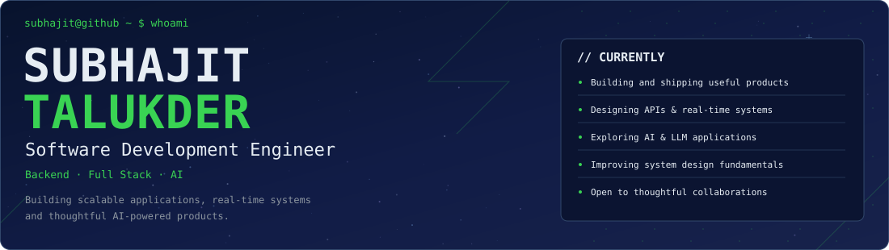
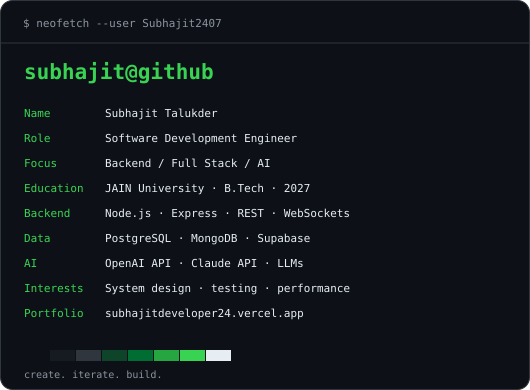
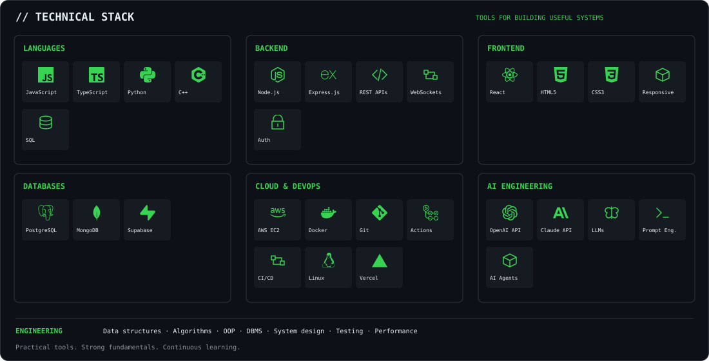
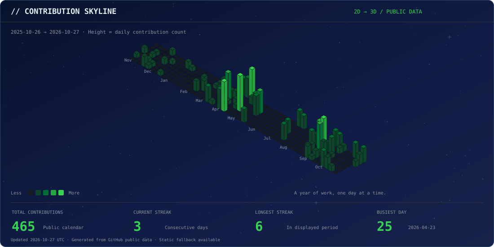
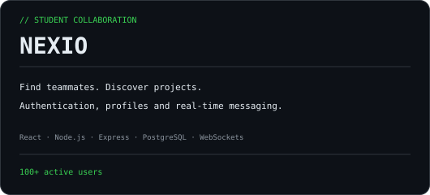
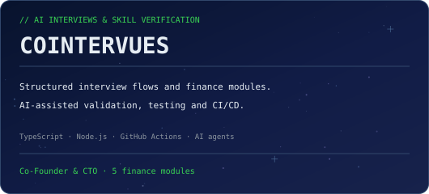
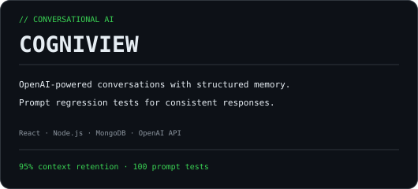
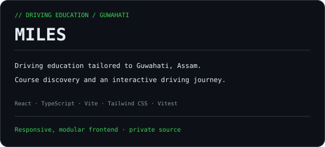
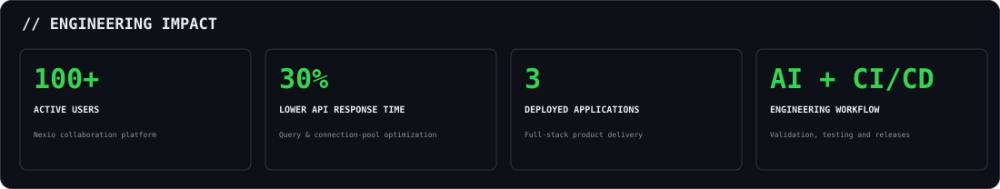

  <a href="#engineering-profile">About</a> &nbsp;·&nbsp;
  <a href="#technical-stack">Skills</a> &nbsp;·&nbsp;
  <a href="#contribution-skyline">Activity</a> &nbsp;·&nbsp;
  <a href="#featured-projects">Projects</a> &nbsp;·&nbsp;
  <a href="#contact">Contact</a>

<h3 align="center">Engineering Profile</h3>

B.Tech Computer Engineering student at JAIN University, graduating in 2027. I build scalable applications, real-time systems, and useful AI-powered products.

<h3 align="center">Technical Stack</h3>

View the stack as text

| Area | Technologies &amp; interests |
| :--- | :--- |
| Languages | JavaScript · TypeScript · Python · C++ · SQL |
| Backend | Node.js · Express.js · REST APIs · WebSockets · Authentication |
| Frontend | React · HTML5 · CSS3 · Responsive Design |
| Databases | PostgreSQL · MongoDB · Supabase |
| Cloud &amp; DevOps | AWS EC2 · Docker · Git · GitHub Actions · CI/CD · Linux · Vercel |
| AI Engineering | OpenAI API · Claude API · LLMs · Prompt Engineering · AI Coding Agents |
| Engineering | Data Structures · Algorithms · OOP · DBMS · System Design Fundamentals · Testing · Performance Optimization |

<h3 align="center">Contribution Skyline</h3>

<picture>
  <source media="(prefers-reduced-motion: reduce)" srcset="./assets/contributions-static.svg" />
  
</picture>

Actual public GitHub activity · Updated daily · <a href="./assets/contributions-static.svg">Static skyline</a> · <a href="./data/contributions.json">Source data</a>

<h3 align="center">Featured Projects</h3>

 

<a href="https://subhajitdeveloper24.vercel.app/projects">Explore my work ↗</a> &nbsp;·&nbsp; <a href="https://github.com/Subhajit2407?tab=repositories">Browse public repositories ↗</a>

<h3 align="center">Engineering Impact</h3>

<h3 align="center">Contact</h3>

<a href="https://github.com/Subhajit2407">GitHub ↗</a> &nbsp;·&nbsp;
<a href="https://www.linkedin.com/in/subhajit-talukder-b73bb229b/">LinkedIn ↗</a> &nbsp;·&nbsp;
<a href="https://subhajitdeveloper24.vercel.app/">Portfolio ↗</a> &nbsp;·&nbsp;
<a href="mailto:subhajittalukder24@gmail.com">Email ↗</a>

<samp>create. iterate. build.</samp>

ASCII terminal approach inspired by <a href="https://www.avivashishta.com/blog/build-animated-github-profile-readme">Avi Vashishta</a>. The supplied React skyline is preserved in <a href="./src/components/ui/contribution-skyline.tsx">source</a>; the README uses generated SVGs.
